# The basics: towards a publication-ready tree

This vignette walks through the main steps of editing a tree in tree2go, from opening a set of trees to exporting the final figure. It covers most of the basic options for customizing a tree and turning it into a publication-ready figure. More specific functions are covered in other vignettes.

These short tutorials are not meant to explain every menu in detail, but to give a quick overview of the options available. For more detailed information, see the [options reference guide](https://vr-daniel.github.io/tree2go/#reference).

As an example, we use a simulated dataset that includes everything needed to show most of what tree2go can do. It has 31 vertebrate species: 24 living and 7 fossils. Although the example uses real species names, and its values were chosen to look reasonable from a biological point of view, all the data are fictitious. **Any pattern or conclusion drawn from these data has no biological meaning.**

## 1. The files we need

Phylogenetic trees and networks come from many different programs and methods, and in many flavors. For this tutorial, we prepared a set of ready-to-use files, grouped in folders that follow the sections of the left panel of tree2go. They cover many of the file types and formats you may come across in phylogenetic analyses, so they can also serve as a reference later, when you import your own data. The files can be downloaded from [this link](#), and are as follows:

```text
vertebrates/
├── Tree/
│   ├── vertebrates_ml.nwk                    Maximum-likelihood tree (Newick), branch lengths in substitutions per site
│   ├── vertebrates_mcc.tre                   MCC tree (NEXUS), branch lengths in time, with a fictitious morphological rate
│   └── vertebrates_posterior.trees           10,001 time-calibrated trees (NEXUS) from a Bayesian analysis
├── Clades/
│   └── clade_groups.txt                      Clades to highlight (one per line), as Clade={sp1, sp2, …}
├── Phylogenetic networks/
│   └── heliconius_network.nwk                Network of Heliconius butterflies (eNewick), with a hybrid species and an introgression
├── Ancestral reconstructions/
│   └── vertebrates_habitat.simmap            100 stochastic character maps for habitat (SIMMAP format, as written by phytools)
├── Attachments/
│   ├── regions.csv                           Presence (1) or absence (0) of each species in different geographic regions
│   ├── traits.csv                            Categorical and continuous traits of each species
│   ├── vertebrates_traits_heatmap.csv        Five continuous traits of each species
│   └── vertebrates_alignment.fasta           100 bp DNA alignment of the living species (FASTA)
├── Geography/
│   └── fossil_records.csv                    Occurrence records from the sampling sites of the fossil species
└── Tanglegram/
    └── vertebrates_alternative.nwk           The same tree with an alternative topology (Newick)
```

## 2. Opening a tree or a set of trees

Click `Open tree` in the **Tree** section of the left panel. tree2go reads files in NEXUS and Newick formats, whatever their extension. A file with a single tree is drawn right away. A file with many trees, such as the posterior sample of a Bayesian analysis, is read as a **tree set**.

If the file holds more than 10,000 trees, a window opens before reading them (Fig. 1A), where you can choose:

- *Burn-in*: the percentage of the first trees to leave out.
- *Keep*: how many trees to keep after the burn-in, as a number or a percentage.
- *Which trees*: whether the trees kept are evenly spaced or picked at random (with a seed, so that the same sample can be drawn again).

The same window opens when you choose several files of trees at once, such as the `.t` files of the runs of one MrBayes analysis. In that case, tree2go reads them as a single tree set: the burn-in is applied to each run, the same number of trees is kept from each, and the trees kept are combined. Later, in the **Tree** section, you can choose which runs to use (*Runs used*) and see how well they agree (ASDSF).

tree2go also checks the structure of the annotations of the trees when reading a file. When braces or brackets do not pair, which can happen when a file goes through several programs, the app detects it in most cases and offers to repair it (Fig. 1B). This is a real problem that usually goes unnoticed, since the file still opens, but it silently breaks the calculations and plots that rely on those annotations. tree2go repairs only the structure of the annotations: it cannot recover values that other programs lost or changed.

<figure class="vfig pair">
  <div class="vrow">
    <figure>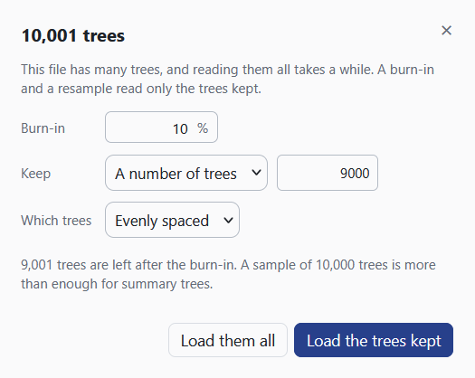<figcaption><b>Figure 1A.</b> The window shown before reading a file with more than 10,000 trees, with a burn-in and the number of trees to keep.</figcaption></figure>
    <figure>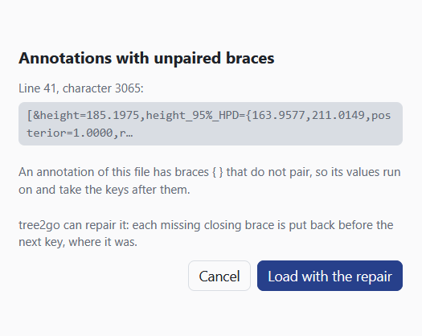<figcaption><b>Figure 1B.</b> The window shown when opening a file whose annotations have unpaired braces.</figcaption></figure>
  </div>
</figure>

For this tutorial, let’s open `vertebrates_posterior.trees`, which holds 10,001 trees. In the window, we set a burn-in of `10`% and keep all the 9,001 trees left after it (Fig. 1A).

> **Note.** The more trees a file has, the more memory it needs. tree2go has no limit of its own beyond the memory the browser gives each tab, but very large samples slow the app down, depending on the number of tips and on the annotations of each tree. As a rule, a sample of 10,000 trees is more than enough for summary trees.

## 3. Summarizing the trees

Once the trees are read, the **Tree** section shows how many were kept (Fig. 2). From there, you can show any single tree of the set, or build a summary tree: a consensus (strict, majority-rule or maximum compatible), a maximum clade credibility (MCC) tree, or a maximum a posteriori (MAP) tree. The MAP tree also needs the `.p` file of MrBayes or the `.log` file of BEAST2, attached in **Attachments**.

Here we build an MCC tree, which should be almost identical to the one in `vertebrates_mcc.tre`. Since we already left out 10% of the trees when reading the file, we keep the *Burn-in* of this section at `0`. And since the trees are time-calibrated, we set *Node ages* to `Median`, so that each node takes the median of its ages across the sample. Then we click `Build summary tree`.

<figure class="vfig">
  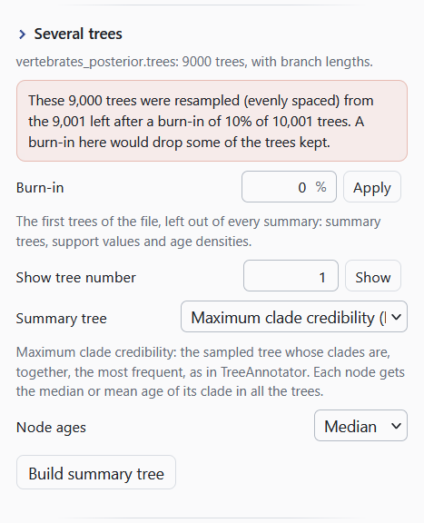
  <figcaption><b>Figure 2.</b> The Tree section, building an MCC tree with median node ages from the sample of trees.</figcaption>
</figure>

The **Tree** section also has a **Reading properties** subsection, with two options that make large files lighter to work with. Both take effect with the next file you open:

- *Significant digits of branch lengths* (from 1 to 10): fewer digits use less memory, but can round very short branches.
- *Keep the trees in a compact binary form*: keeps a lighter copy of each tree in memory. When it is off, the trees are kept as text, which slows the app down with very large files.

## 4. Arranging the tree

The **Layout** section changes the shape of the tree and its size. As a rule, every option in the left panel changes the whole tree at once, while a `Right-click` on any element of the canvas changes only that element (or the elements selected).

Here we set **Layout** > *Order nodes* to `Decreasing`, so that larger clades go to the bottom, and give the root a short branch of `25` px with **Layout** > *Root branch*, which marks where the tree begins (Fig. 3A–B). Both are purely aesthetic choices. Feel free to try the other shapes and options. Every element on the canvas adapts to these changes.

<figure class="vfig pair">
  <div class="vrow">
    <figure>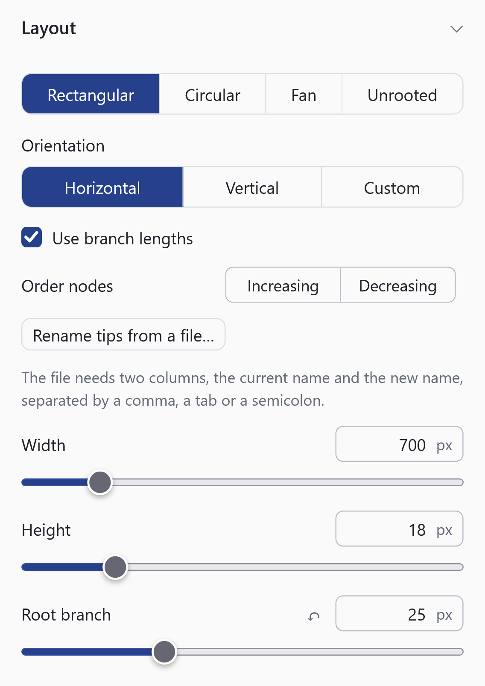<figcaption><b>Figure 3A.</b> Layout options.</figcaption></figure>
    <figure>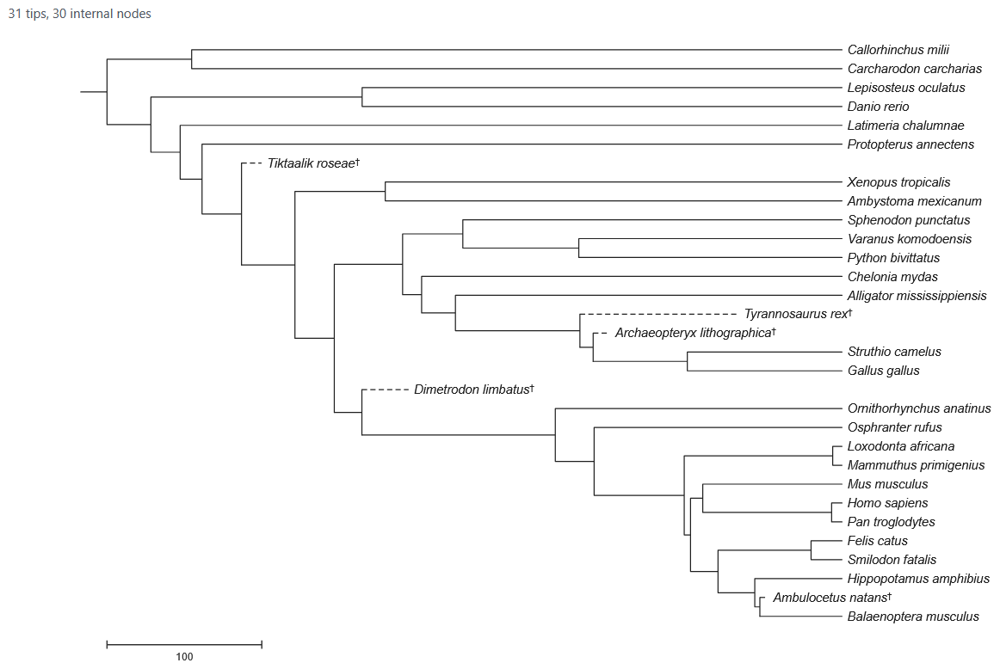<figcaption><b>Figure 3B.</b> The MCC tree, with its clades ordered by size and a short root branch.</figcaption></figure>
  </div>
</figure>

Although we do not use it in the final figure, the **Tree cloud** section draws all the trees of the set on top of each other, as DensiTree does (Fig. 4), to show the uncertainty in the topology and the ages. It is available only for tree sets.

<figure class="vfig">
  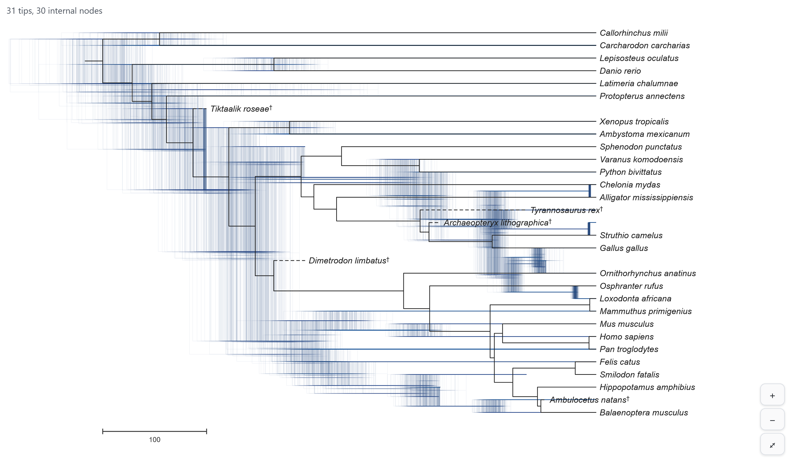
  <figcaption><b>Figure 4.</b> The trees of the sample drawn as a tree cloud.</figcaption>
</figure>

> **Note.** You can customize the look of the tree cloud: line width, color, opacity, how many trees are drawn and how they are picked. Since drawing many trees can slow the app down, we recommend turning off **Tree cloud** > *Show the trees of the sample* while you keep editing, and turning it back on before exporting. tree2go remembers your choices in this section.

## 5. Branches

The **Branches** section sets the look of every branch. In trees with both living and extinct species, the branches of extinct tips are dashed by default, and their names carry a dagger (†). To change this for some branches only, select them with `Shift` + click and change their look from their `Right-click` menu. In trees of extinct species only, or in trees not calibrated in time, all branches are solid by default.

The **Color by data** and **Width by data** subsections color the branches, or change their width, according to any value of the tree (Fig. 5A): its own annotations, or a table attached in the **Attachments** section. The colors can be chosen one by one (`Custom colors`) or taken from a palette, several of which are safe for color blindness.

In our example, we set **Branches** > *Line width* to `1.5` px and, in **Color by data**, color the branches by `rate_median`, which here stands for a rate of morphological evolution from a Bayesian analysis, with the `Magma` palette (Fig. 5B).

<figure class="vfig pair">
  <div class="vrow">
    <figure>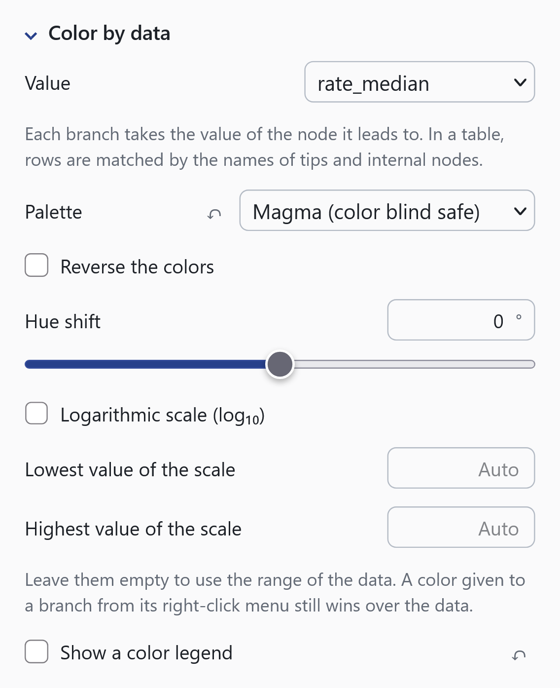<figcaption><b>Figure 5A.</b> Color by data options.</figcaption></figure>
    <figure>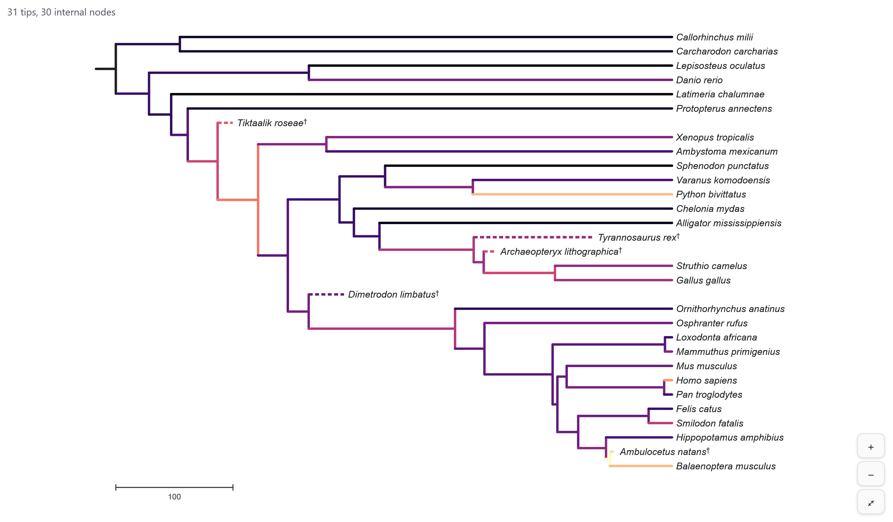<figcaption><b>Figure 5B.</b> Branches colored by their evolutionary rate with a color-blind-safe palette.</figcaption></figure>
  </div>
</figure>

> **Note.** The palette of the whole session is set in `Page settings`, in the header. It changes the colors offered from then on, but not the ones already given to elements. The same menu has `Page settings` > *Color blind preview*, which shows the figure as seen with different color vision deficiencies. It only changes what you see on screen: the figure keeps its colors when you go back to normal vision or export it.

## 6. Values, nodes and their uncertainty

The **Branch values** section writes any value of the tree or of an attached table on each branch, and sets how it looks: position, alignment, size, color and number of decimals.

The **Nodes** section adds symbols to internal nodes and tips, with the same look for all of them or a look set by a value of the tree or of an attached table.

The **Node values** section gathers the values usually shown at the nodes:

- **Support values**: as numbers or as symbols, whose color or size changes with the value. To keep the figure clean, you can show only the values within a range you choose.
- **Other node labels**: any other value of the tree or of an attached table, with several ways to align it.
- **Node bars**: for time-calibrated trees with uncertainty in their ages, such as our MCC tree, the uncertainty of each node can be drawn as an HPD bar or as a violin (*Show the ages as*). Their look, size and color can be changed as for any other element.

In our example, we first show the **Support values** as numbers, leaving every other option as it is. Then, in **Other node labels**, we *Show* `Age, median of the trees` as a number, and set *Stack with the support values* to `Below the branch` (Fig. 6A). Feel free to explore other options that may fit the visual goal you want to achieve.

<figure class="vfig pair">
  <div class="vrow">
    <figure>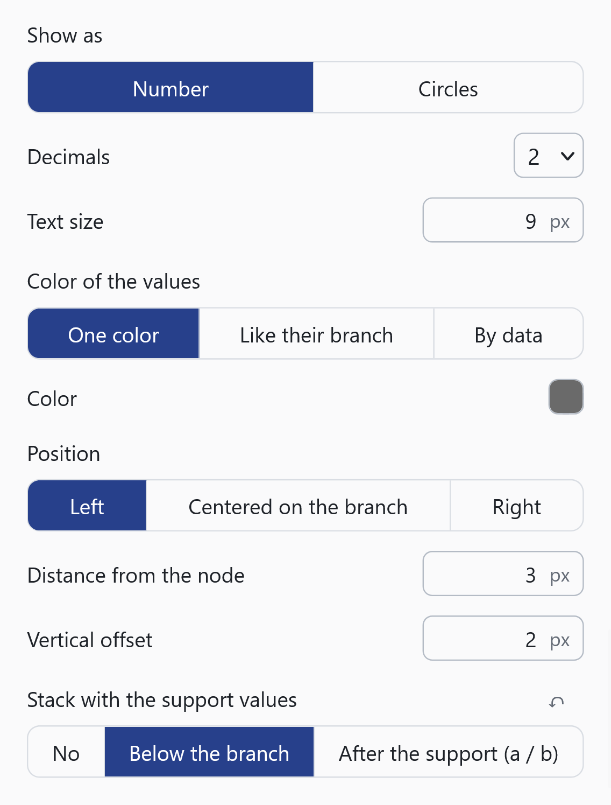<figcaption><b>Figure 6A.</b> Support values and node ages in the Node values section.</figcaption></figure>
    <figure>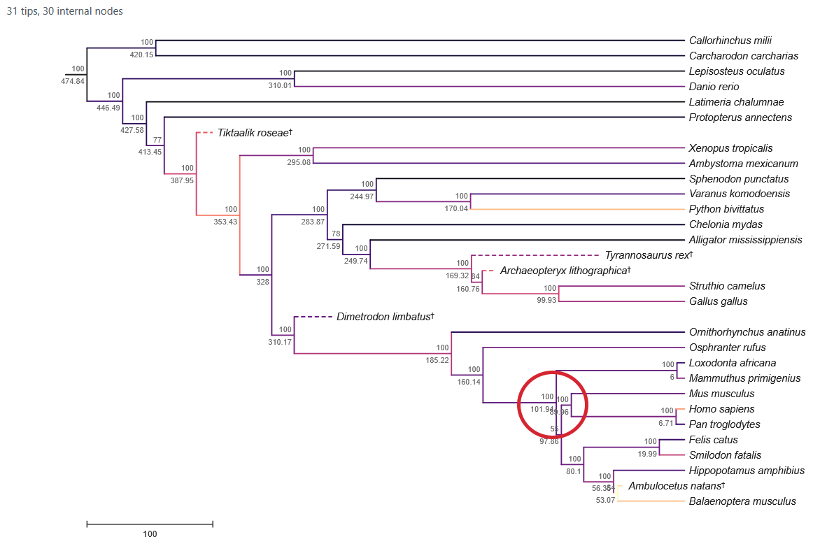<figcaption><b>Figure 6B.</b> The age of each node shown as a second value, below its support.</figcaption></figure>
  </div>
</figure>

In many cases, especially in large clades with short branches, some values end up on top of each other (red circle in Fig. 6B). There are several ways around this. One is to move each overlapping label on its own, changing its offset from its `Right-click` menu. Another, which we follow here, is to replace the numbers with symbols whose size and color give a visual cue of their value.

To do so, we hide the node ages again and switch the support values from `Number` to `Circles`. Then, under *Which values*, we choose `By categories`, with three ranges: black for supports below 80, blue from 80 to 95, and red above 95. We also keep a different circle size for each range (Fig. 7A–B).

<figure class="vfig pair">
  <div class="vrow">
    <figure>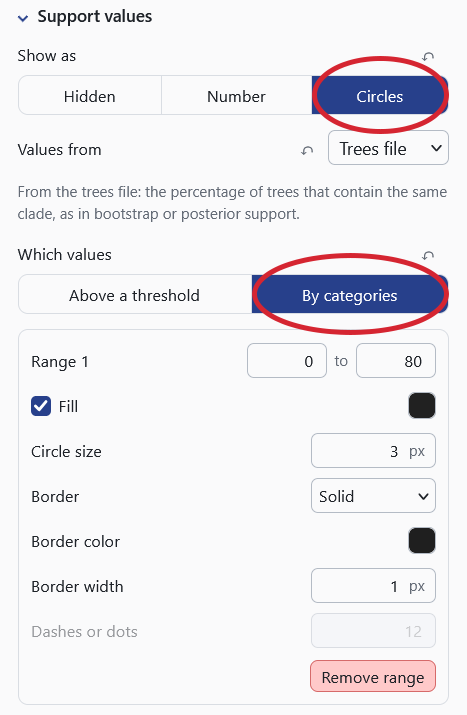<figcaption><b>Figure 7A.</b> Support values shown as symbols, by categories.</figcaption></figure>
    <figure>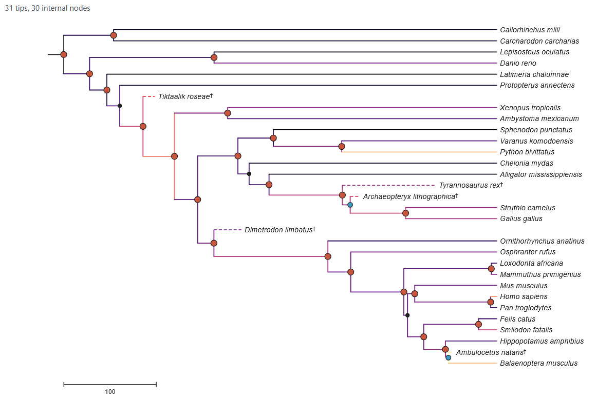<figcaption><b>Figure 7B.</b> The tree with its support values shown as symbols.</figcaption></figure>
  </div>
</figure>

Next, since our tree comes from a sample of trees, we can show the uncertainty in the node ages. Some programs write it in the annotations of a single tree, as a 95% HPD range, which can be drawn as a bar. Since we have the whole sample, we can go one step further and show how the ages are distributed within that range, as violin plots, from the **Node bars** subsection (Fig. 8A–B). Like any other element in the app, violin plots can be fully customized in size and color, and can also show other values, such as the mean and the median.

<figure class="vfig pair">
  <div class="vrow">
    <figure>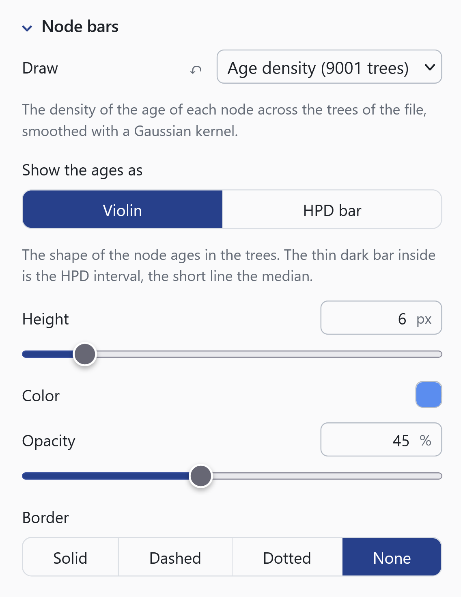<figcaption><b>Figure 8A.</b> The Node bars subsection, where the ages can be shown as an HPD bar or as densities.</figcaption></figure>
    <figure>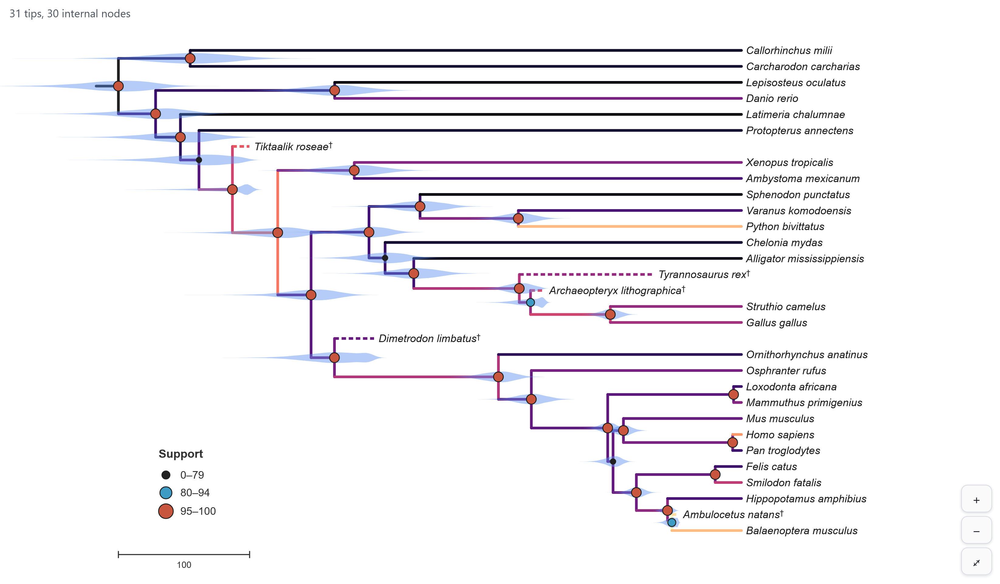<figcaption><b>Figure 8B.</b> The tree with violin plots on its nodes, showing the uncertainty of the ages across the sample.</figcaption></figure>
  </div>
</figure>

> **Note.** In dated trees, the median of the HPD bars and violin plots should sit on the nodes. tree2go recognizes from the trees themselves whether their branch lengths are in time. In some trees, however, the structure is ambiguous, and dated trees can be read as not dated, which leaves the medians of the distributions off their nodes. If this happens, tell the app that the trees are dated with **Tree** > *Trees in time*.

## 7. Tip labels

The **Tip labels** section sets the look and position of the tip names. Here we turn on *Align labels to the right*, so that all names end in one column (Fig. 9A–B). This is especially useful in trees whose tips do not all reach the present, such as trees with fossils, or in trees with branch lengths in substitutions per site.

<figure class="vfig pair">
  <div class="vrow">
    <figure><figcaption><b>Figure 9A.</b> Tip labels not aligned.</figcaption></figure>
    <figure>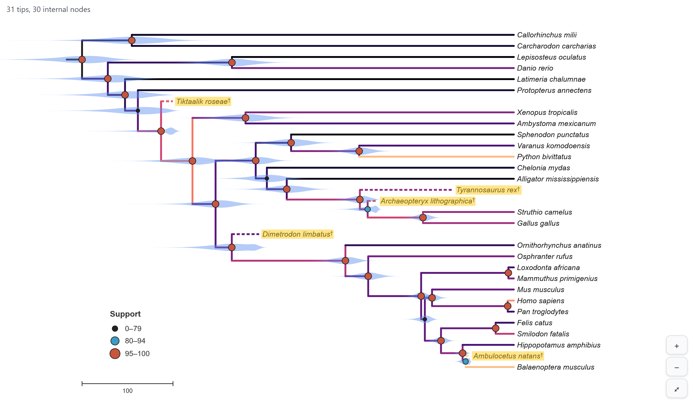<figcaption><b>Figure 9B.</b> Tip labels aligned in one column, with the fossil tips highlighted in yellow to make the change easier to see.</figcaption></figure>
  </div>
</figure>

As mentioned before, tree2go recognizes the kind of tree automatically, and with it the branches that belong to fossils. But a closer look at our example shows that *Mammuthus primigenius* (woolly mammoth) and *Smilodon fatalis* (saber-toothed cat) have neither a dashed branch nor the dagger that marks them as fossils. This is not an error, but a matter of the scale of the tree.

To tell fossils from living species, tree2go allows a small tolerance: tips that end within 0.5% of the tree height from the present still count as living, so that rounded branch lengths do not turn living species into fossils. In a tree that spans more than 450 million years, like ours, that 0.5% is more than two million years, and both species went extinct only about 12,000 years ago. The fix is simple: we lower **Fossils** > *Tolerance (% of the tree height)* to a very small value, such as `0.001` (Fig. 10A–B).

<figure class="vfig pair">
  <div class="vrow">
    <figure>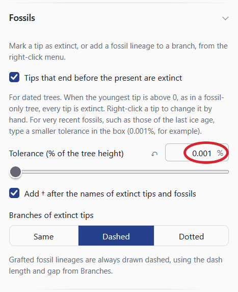<figcaption><b>Figure 10A.</b> The Fossils section and its options.</figcaption></figure>
    <figure>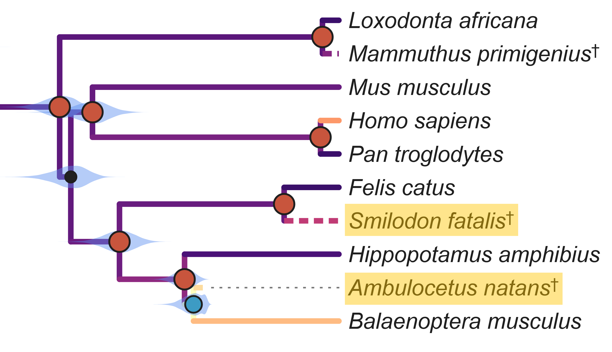<figcaption><b>Figure 10B.</b> The fossil tips after lowering the tolerance.</figcaption></figure>
  </div>
</figure>

> **Note.** Like any other element, tip labels can be edited one by one from their `Right-click` menu, or several at once after selecting them with `Shift` + click. Renaming a tip only changes the name shown. The original name stays underneath, so the tip keeps its link to any attached data. When some tips were renamed and the tree is exported as NEXUS or Newick, tree2go asks whether to write the new names, as they appear in the figure, or the original ones.

## 8. Clades

The **Clades** section highlights and names clades, and sets the look of their highlights and name bars. Clades can be picked directly on the canvas, using `Select mode` in the header:

- `Element` selects one node or one branch.
- `Clade` selects a node with all its descendants.

Highlights and names apply to the selection, and can cover the whole clade, only its living lineages (crown), or only its extinct ones (stem). A highlight can be a solid block of color or a gradient, from left to right or from right to left.

If you already know which tips belong to each group, you can also write a plain text file, such as `clade_groups.txt`, with one clade per line in the format `Clade={sp1, sp2, …}`. Each clade needs at least two tips, written as they appear in the tree. With `Highlight clades from a file…` or `Name clades from a file…`, tree2go finds the most recent common ancestor of the tips of each clade, and highlights or names that clade for you (Fig. 11A).

<figure class="vfig pair">
  <div class="vrow">
    <figure>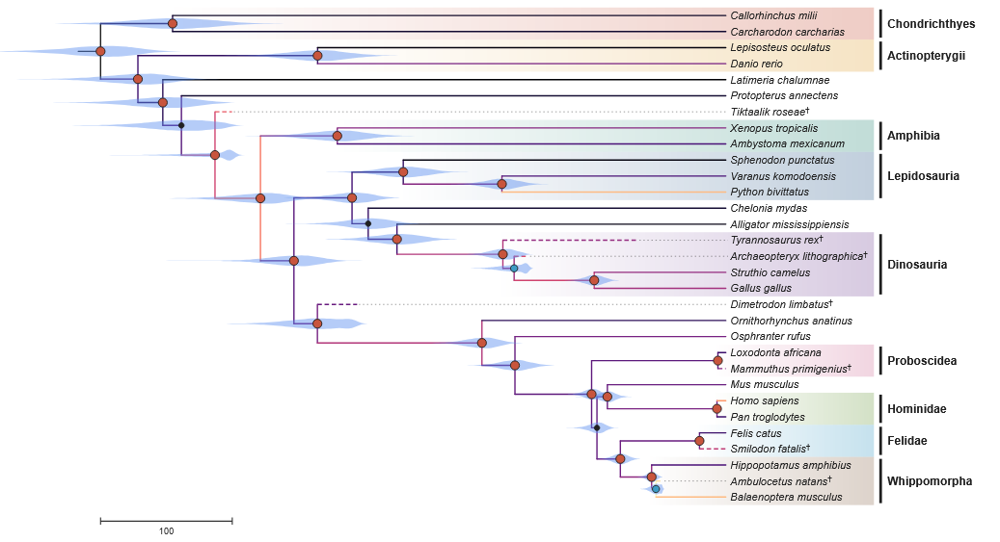<figcaption><b>Figure 11A.</b> The tree with some of its major clades highlighted from a file.</figcaption></figure>
    <figure>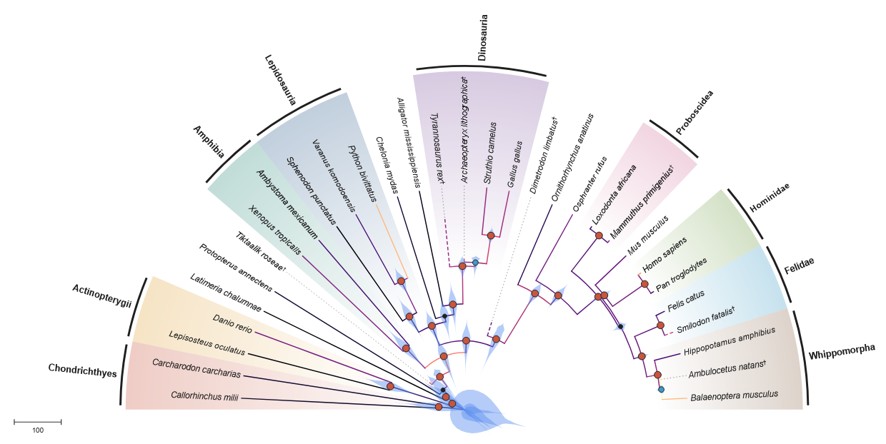<figcaption><b>Figure 11B.</b> The same tree, with its highlighted clades, in fan layout.</figcaption></figure>
  </div>
</figure>

Every change is kept when the layout changes (rectangular, circular, fan or unrooted), unless it cannot be drawn in the new layout, such as a sequence alignment on a circular tree. Also, although the app is designed to adapt to every layout, some elements that can be carried over from one layout to another are not practical in all of them. For example, violin plots on a circular or fan tree overlap each other towards the root (Fig. 11B).

## 9. Legends and placing elements

As we add elements that carry colors, symbols or sizes, tree2go adds their legends at the bottom left of the figure. Every legend can be moved and restyled, and hidden from its `Right-click` menu or from the **Legends** section. By default, legends are locked in place, as shown by the blue lock at their top right corner. A click on the lock turns it yellow and frees the legend, which can then be dragged anywhere on the canvas, like images and plots.

While an element is being moved, dotted guides show the other elements around it, each with its distance (Fig. 12). Click the blue bubble of a distance to type an exact value, and the element moves there.

<figure class="vfig">
  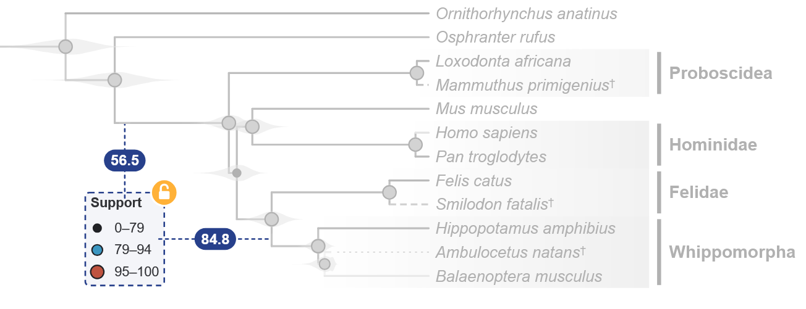
  <figcaption><b>Figure 12.</b> Moving a legend freely, with the guides and distances to the elements around it.</figcaption>
</figure>

## 10. Time axis and geologic time scale

For time-calibrated trees, `Show time axis` in the **Time axis** section adds an axis of ages under the tree, or above it with *Position*. Its subsections set the axis:

- **Ages**: among other options, an offset for trees of fossils only, in which no species reaches the present. When this value changes, every label that shows an age updates automatically.
- **Ticks** and **Axis look**: where the ticks go and how the axis looks.
- **Geologic time scale**: boxes with the geologic intervals, in the colors of the Geological Society of America (GSA Geologic Time Scale v. 6.0), and backgrounds that shade those intervals, or ranges of your own, behind the tree (Fig. 13).

<figure class="vfig">
  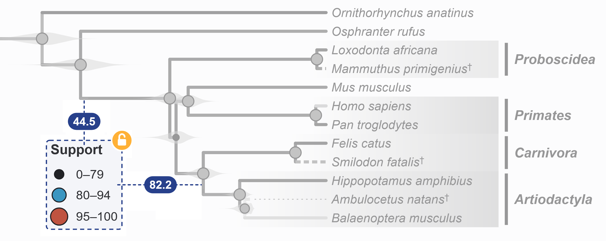
  <figcaption><b>Figure 13.</b> A time axis with the geologic time scale under the tree.</figcaption>
</figure>

> **Note.** As with the other elements of the figure, most of the look of the time axis and the geologic time scale can be customized. The only exception is the colors of the geologic boxes, which follow an international convention. You can also add a second time axis with a different scale (**Time axis** > *Show a second axis*), and shade intervals behind the tree, either standard geologic intervals or ranges you define. The time axis also works on circular and fan trees, as concentric rings, but the geologic boxes are not drawn there, since they do not fit a radial layout.

## 11. Splitting a long tree into pages

A tree too tall for one printed page can be split from the **Split into pages** section. tree2go finds the clades that go on each page, for the number of pages you choose, and shows the limits of each page on the canvas as dashed boxes (Fig. 14). To move a limit, drag it.

Each page has the same width, and can carry its own time axis or geologic time scale. A miniature of the whole tree (the tree map) shows, on each page, where its clades are in the tree. Its position, colors and highlight are set from its `Right-click` menu. When exporting, you can save the whole tree in one file, or each page as a file of its own.

<figure class="vfig">
  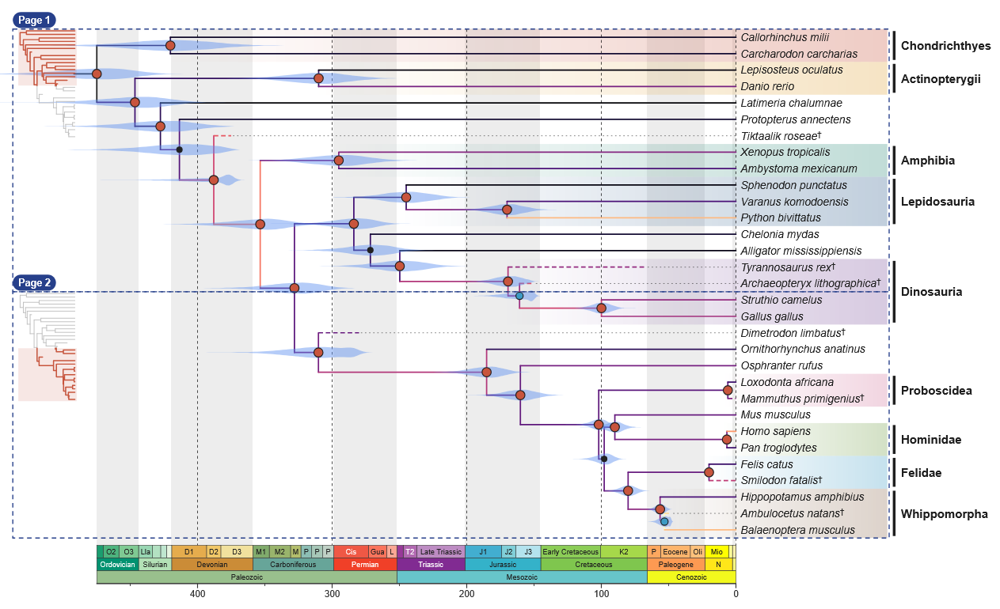
  <figcaption><b>Figure 14.</b> A tree split into pages, each with a miniature of the whole tree.</figcaption>
</figure>

> **Note.** When a figure with a time axis or a geologic time scale is split into pages, you can repeat the axis under each page or show it only on the last one, with **Split into pages** > *Repeat the time axis under each page*, in its **Look** subsection. The change does not show on the canvas, only in the exported files.

## 12. Pie charts on the nodes

Sometimes we have, for each node, an estimate made of proportions, such as the state probabilities of an ancestral state reconstruction. tree2go can draw them as pie charts on the nodes, for one character or several, and color the branches by their most probable states.

To keep our styled tree as it is, we first copy it to a new tab and start the copy from the default look. `Right-click` the root of the tree and choose `Copy tree to a new tab` (Fig. 15). A window then asks whether the copy keeps the same look or starts from the default one, and here we choose `Default look`. To reset the look of the current tab instead, use `Reset styles` in `Page settings`. If you `Right-click` any other node instead of the root, `Extract clade` opens only that clade in a new tab.

<figure class="vfig">
  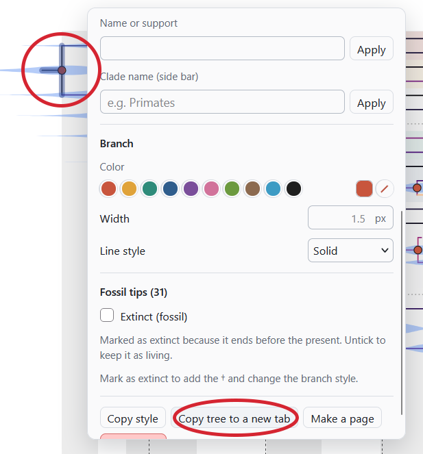
  <figcaption><b>Figure 15.</b> Copying the tree to a new tab.</figcaption>
</figure>

To rename the new tab, double-click its name. Then, in the **Attachments** section, click `Add file` and choose `vertebrates_habitat.simmap`. The nodes of the tree turn into pie charts right away. Their look is set in the **Ancestral reconstructions** section (Fig. 16A), where the branches can also be colored by state with **Ancestral reconstructions** > *Color the branches*: by the maximum a posteriori state, by the most probable states above a threshold, or as a probability gradient. Since the pies take the place of the node dots, their size and border are set in the **Nodes** section, like any other dot.

<figure class="vfig pair">
  <div class="vrow">
    <figure>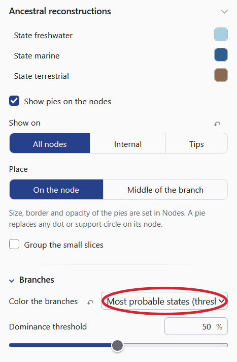<figcaption><b>Figure 16A.</b> The Ancestral reconstructions section.</figcaption></figure>
    <figure>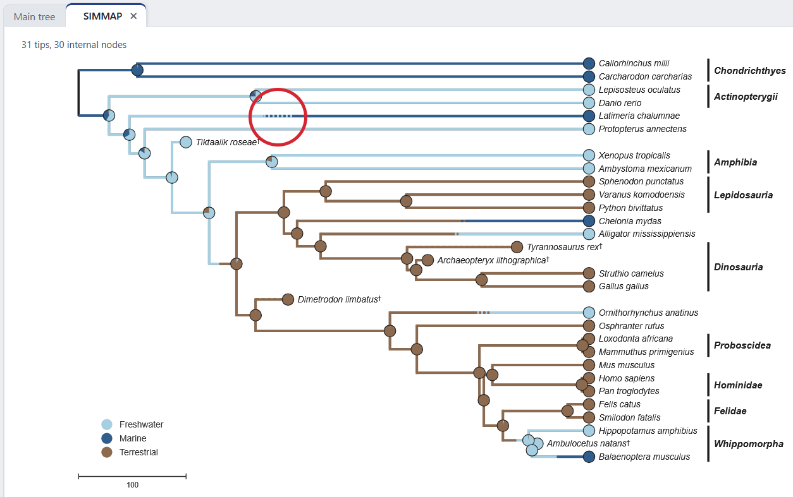<figcaption><b>Figure 16B.</b> Pie charts of habitat on the nodes, and branches colored by their most probable states.</figcaption></figure>
  </div>
</figure>

For this example, we set **Nodes** > *Node dot size* to `9` px and **Branches** > *Line width* to `3` px, gave the pies a black border, moved the legend, and renamed its states from its `Right-click` menu. We also colored the branches with `Most probable states (threshold-based)`. This option sets how dominant a state must be to color a stretch of branch, so the stretches where the state is uncertain stand out as a dashed line (red circle in Fig. 16B).

> **Note.** Pie charts can also come from a file, with `Pie charts from a file…` in the **Pie charts** subsection of **Node values**. The file can be a table with the names in the first column and one column per category, holding the proportion of each, or a plain text file with one line per tip or node, such as `Name | {A:0.3, B:0.7}`, the notation of SIMMAP files. Internal nodes are matched by their names, so the tree needs names on its internal nodes, written as in the file.

## 13. Side plots

One of the most useful features of tree2go is drawing plots side by side with the tips: bar plots, matrices of categories (such as presence and absence), heatmaps of continuous values, and even DNA alignments.

First, in the **Attachments** section, click `Add file` and choose `regions.csv`, `traits.csv`, `vertebrates_traits_heatmap.csv` and `vertebrates_alignment.fasta`, which can be chosen together (Fig. 17A). As described at the beginning of this tutorial, these files hold the geographic distribution of the species, some of their traits, and DNA sequences of the living species. The tables are simple: one column with the names of the tips, and one column for each value. You can make them in any spreadsheet program, such as Excel, and save them as `.csv`. tree2go finds the column with the tip names by itself, and you can choose another one in its *Names in* list in **Attachments** if needed.

<figure class="vfig pair">
  <div class="vrow">
    <figure>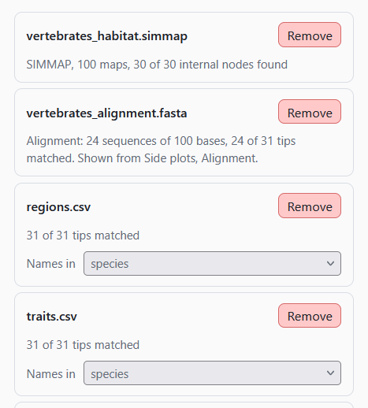<figcaption><b>Figure 17A.</b> The files attached, each with the number of tips of the tree it matches.</figcaption></figure>
    <figure>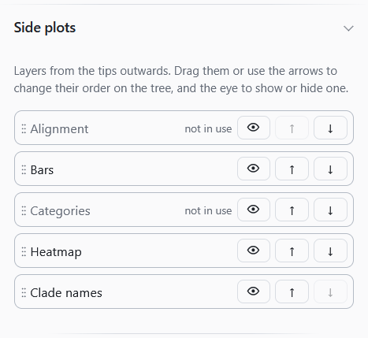<figcaption><b>Figure 17B.</b> The Side plots section, with the plots in their order from the tips outwards.</figcaption></figure>
  </div>
</figure>

Each file attached is listed in the **Attachments** section, with the number of tips of the tree it matches. Here, the geographic distribution (`regions.csv`) and the traits (`traits.csv` and `vertebrates_traits_heatmap.csv`) match 31 of the 31 tips, while the alignment matches only 24, which makes sense, since the 7 fossils have no DNA.

The side plots can be stacked. Several can be shown at once, and their order, from the tips outwards, is changed by dragging them in the list at the top of the **Side plots** section, where the eye icon shows or hides each one (Fig. 17B). The look of each plot is set in its subsection of **Side plots**, and some elements can also be changed one by one from their `Right-click` menu. Some plots can also take the look of the tree, for example coloring the bars by the named clade each tip belongs to (**Side plots** > *Color the bars by named clade*).

<figure class="vfig">
  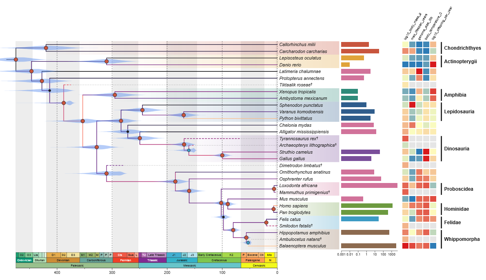
  <figcaption><b>Figure 18.</b> Bars of brain mass on a logarithmic scale, and a heatmap of five continuous traits.</figcaption>
</figure>

In this example, we drew bars of brain mass (`brain_g`, from `traits.csv`), colored by the named clade of each tip, and on a logarithmic scale (**Side plots** > *Logarithmic scale (log₁₀)*), since brain mass goes from a fraction of a gram to several kilograms. Next to them, we drew a heatmap of five continuous traits (`vertebrates_traits_heatmap.csv`): body mass, maximum lifespan, genome size, body temperature and offspring per year. Note that the side plots leave a tip empty when it has no value. Here, the fossils have no bar, since their brain mass is unknown, and in the heatmap they only show their body mass (Fig. 18).

Side plots can also show DNA or protein sequences, straight from a `.fasta` file. Here we use `vertebrates_alignment.fasta`. tree2go gives each base its own color, and the colors can be changed in the **Alignment** subsection of **Side plots**.

<figure class="vfig pair">
  <div class="vrow">
    <figure>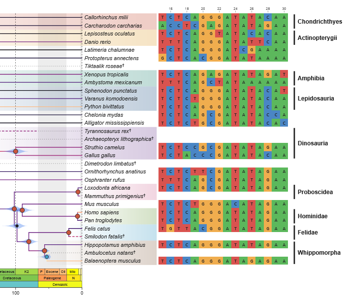<figcaption><b>Figure 19A.</b> Sites 15 to 30 of the alignment, as one square per base.</figcaption></figure>
    <figure>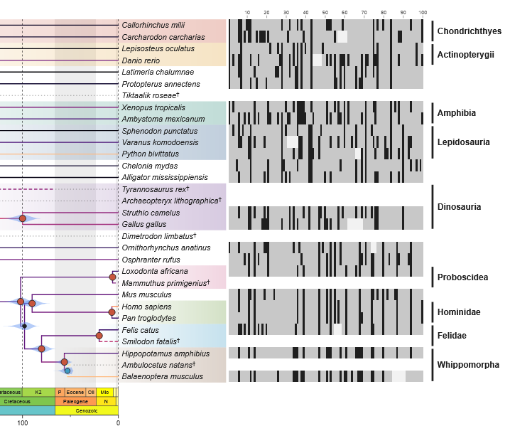<figcaption><b>Figure 19B.</b> The whole alignment, as a barcode.</figcaption></figure>
  </div>
</figure>

How the alignment is drawn depends on how many sites are shown. When they fit in the width of the plot (**Side plots** > *Width*, in **Alignment**), each base is drawn as a colored square, with its letter inside when there is room (Fig. 19A). When they do not fit, the alignment is drawn as a barcode, which marks at each site, in two contrasting colors, the bases that differ from the most common one (Fig. 19B). tree2go works out how many sites fit, and the hint under *Width* tells you. You can also choose which sites to show with *From site* and *To site*.

## 14. Presence and absence in a circular tree

We left binary data for last because, besides drawing them like the other plots, we will combine them with a different layout. For this example, we hide the bars, the heatmap and the alignment with their eye icons in the list of **Side plots**, and keep only **Categories**, with `regions.csv`. Like the other plots, it draws a grid of squares, colored where a species is present and grey where it is absent, and both colors can be changed. Then, in **Layout**, we choose the `Circular` shape and turn the tree inside out with **Layout** > *Turn circular and fan trees inside out*. To lighten the figure, we also removed the violin plots and the node ages, turned the tree into a cladogram by unticking **Layout** > *Use branch lengths*, and widened the center with **Layout** > *Inner radius (center gap)*. Finally, with **Side plots** > *Squares follow the circle*, in **Categories**, the squares become wedges that follow the circle, and *Width of the bands* sets how wide they are (Fig. 20).

<figure class="vfig">
  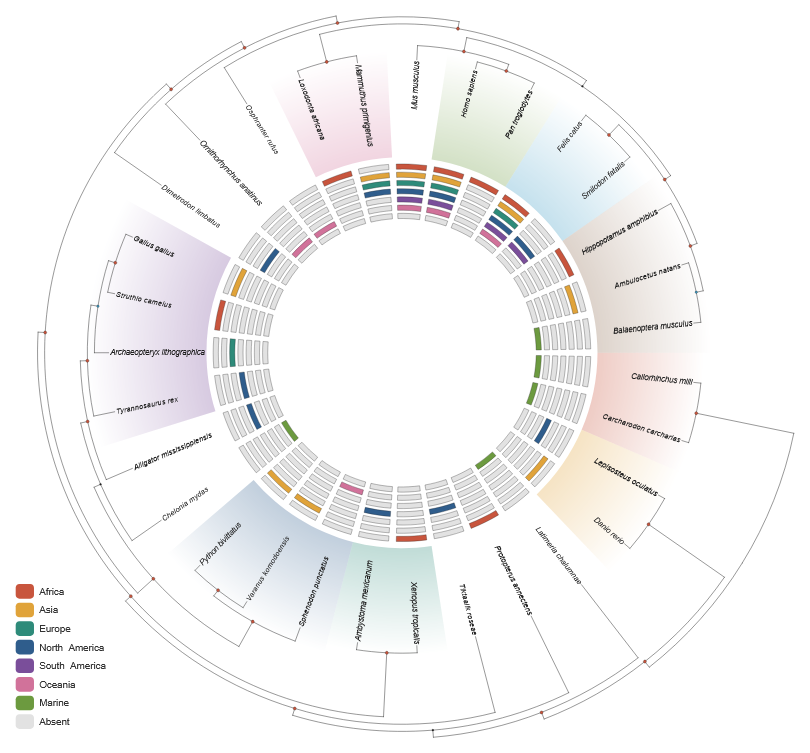
  <figcaption><b>Figure 20.</b> The tree turned inside out, with its presence and absence matrix inside the circle.</figcaption>
</figure>

The result is a view that is especially useful in biogeography, since it shows at a glance both the relationships of the species and their presence and absence in each region. And the space we opened in the center will take our figure one step further in the next section.

## 15. Geography

Another distinctive feature of tree2go is drawing maps with occurrence records right in the app, with no need for GIS software. This is done in the **Geography** section of the left panel (Fig. 21). You can load your own maps as shapefiles (`.shp`, or zipped in a `.zip`), or download basic outlines from [Natural Earth](https://www.naturalearthdata.com) for present-day maps, or from [GPlates](https://www.gplates.org) for paleogeographic reconstructions. Downloading them needs an internet connection.

<figure class="vfig">
  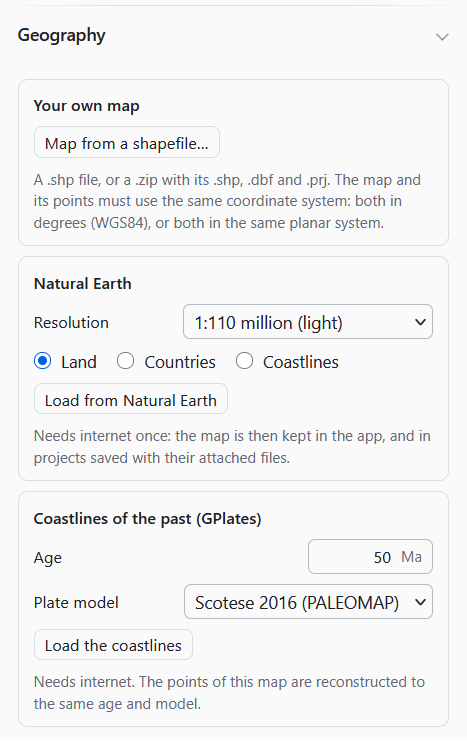
  <figcaption><b>Figure 21.</b> The Geography section.</figcaption>
</figure>

For this example, we use `fossil_records.csv`, with the sampling sites of the seven fossils of our tree. The file needs, at least, one column with the names of the tips, which can repeat when a species has several records, and one column each for longitude and latitude. When the records are many, tree2go can group the nearby ones. Since our fossils span a long stretch of time, we show the records as present-day sampling sites. With GPlates, the coordinates can instead be placed on a paleogeographic reconstruction, from several models, which also needs an internet connection. This is most useful when the fossils are of similar ages and we want to show how their distribution looked at that time.

First, in the **Map** subsection, we download the `Land` outlines of Natural Earth at `1:110 million`, and set **Geography** > *Projection (maps in degrees)* to `Mollweide (ESRI:54009)`, which gives the map an oval shape. The best projection depends on your data and on what you want to show. Then we move the map to the center of the circle, the space we opened in the previous section. Like the other elements, the map has its own `Right-click` menu, which changes not only its look but also its extent and zoom. Directly on the map, `Ctrl` + drag moves the view inside its frame, and `Ctrl` + scroll zooms in and out, as in a GIS.

Next, with `fossil_records.csv` attached in **Attachments**, we choose it in **Geography** > *Table*, in the **Points** subsection, and the records appear on the map. With *Size* set to `By the number of records`, each point grows with the number of records at its site. The size and color of the points can also follow a value of the tree or of an attached table, and the color can follow the named clades or, as here, the highlight of each clade (`As the highlight of its clade`). Figures 22A and 22B show two ways of bringing geographic data into a tree.

<figure class="vfig pair">
  <div class="vrow">
    <figure>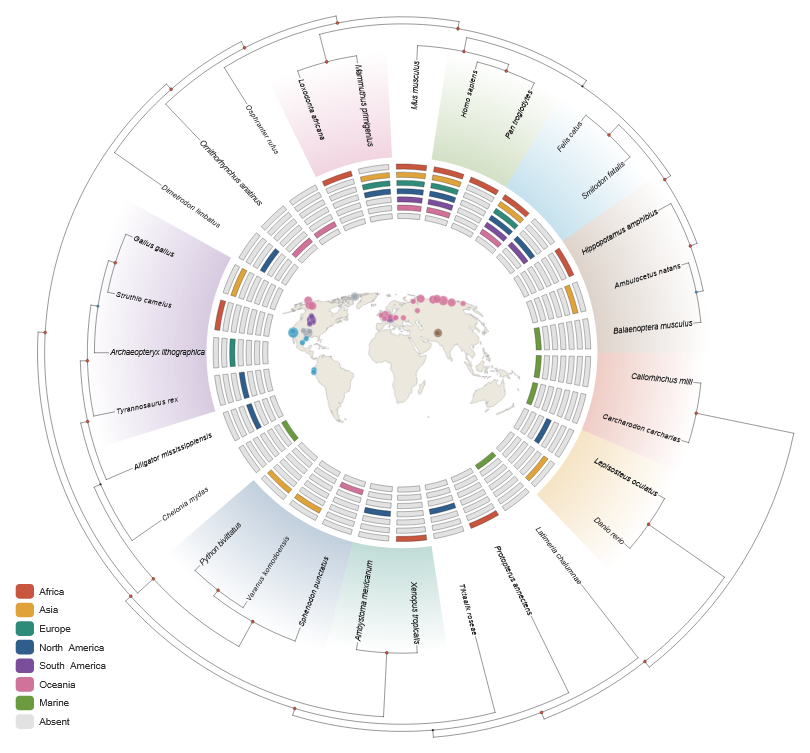<figcaption><b>Figure 22A.</b> The tree with a map of the fossil records in its center. The inner rings show the regions where each species lives or was found, and the points of the map are colored by the highlight of their clade.</figcaption></figure>
    <figure>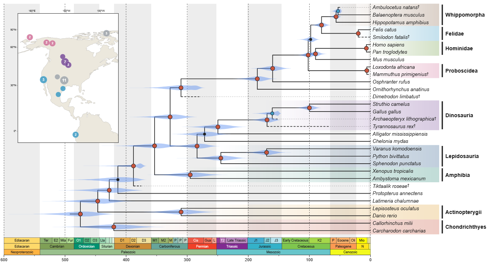<figcaption><b>Figure 22B.</b> An alternative view of a map within a phylogeny. The map shows the occurrence records grouped by geographic proximity and colored by the clades of the tree.</figcaption></figure>
  </div>
</figure>

> **Note.** The **Lines to the tips** subsection joins each tip to its points (**Geography** > *Join each tip to its points*). This helps to show where samples or species come from, especially when each species has one or a few close records. Otherwise, a line is drawn from the tip to every point.

## 16. Images and visual elements

The **Images and visual elements** section adds elements of your own to the figure:

- `Add image`: a picture, such as a silhouette or a photo, in PNG or JPEG.
- `Add label`: a free text, which can be lined up with the tree.
- `Draw arrow`: an arrow, which can be anchored to nodes and images, so it follows them when the tree changes.
- `Add density plot`: the distribution of a value of the tree, such as rates.
- `Add LTT plot`: a lineages-through-time plot, for the whole tree or for named clades.

Like legends, they can be moved anywhere, with guides and distances to the elements around them, and styled from their `Right-click` menu.

## 17. Tanglegram

Tanglegrams are another common figure in comparative phylogenetics: two trees face to face, usually with alternative topologies, with lines joining their matching tips. In the **Tanglegram** section, the second tree can be any tree of the set (`Open a tree of the set`) or a tree from a file (`Load a tree file in a new tab`). Here we load `vertebrates_alternative.nwk` (Fig. 23).

<figure class="vfig">
  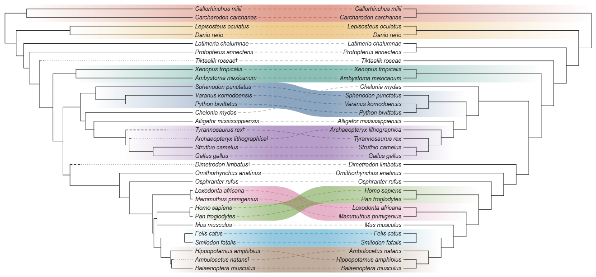
  <figcaption><b>Figure 23.</b> A tanglegram of the main tree and a tree with an alternative topology.</figcaption>
</figure>

The second tree opens in a tab of its own, and is drawn with the look of that tab: its alignment of names, branch colors and highlights are set there, as for any other tree. From the main tree it only takes its size: its tips spread over the same height, and its width is the same unless set otherwise in **Tanglegram** > *Width (0 as this tree)*. With **Tanglegram** > *Join the highlights of the same clade*, the highlights of a clade in both trees are joined across. The order of its branches is its own, and to make the lines cross as little as possible, the main tree offers `Untangle (turn the second tree)`, which rotates the nodes of the second tree only, and `Untangle both`, which rotates the nodes of both trees.

## 18. Saving and exporting

tree2go keeps your work in two ways. First, as long as the data of the browser are not cleared, the app remembers your session even after you close it: the next time you open tree2go, your trees, tabs, look and attached files are there, exactly as you left them. `Clear session`, in the header, removes everything to start again. A session, however, lives only in that browser, so we recommend saving your work as a project from time to time.

From `Save` in the header, you can save:

- `Project`: the trees and everything that goes with them, including tabs, look, tables, alignments, maps, images and, if you choose, every tree of a set. It opens again later, on any computer, from `Import` > `Project`. When saving it, a window lets you leave out the attached files or the trees of the set, and compress the file, which makes it much lighter.
- `Style`: only the look of the figure, without its tree or data. A style can be applied to another tree from `Import` > `Style`, which is handy for giving all the figures of a paper the same look.

Finally, export the figure from `Export`, as SVG or PDF, vector files that stay sharp at any size, or as PNG or TIFF, at the resolution and size you choose. The same menu saves the tree as it is now, with its names, rooting and order, in Newick or NEXUS, and, for a tree set, the trees of the sample.

## 19. Phylogenetic networks

Although it is not part of our vertebrate example, one section is left to explore: **Phylogenetic networks**. The history of a group is not always a tree: when lineages exchange genes, through hybridization or introgression, it is better drawn as a network. tree2go reads networks in extended Newick (eNewick), as written by PhyloNet or SNaQ, where each reticulation is marked with a label such as `#H1`.

As an example, we use `heliconius_network.nwk`, a small network of *Heliconius* butterflies inspired by two well-known cases, with fictitious values: *H. heurippa*, a species of hybrid origin between *H. cydno* and *H. melpomene*, and *H. timareta*, which received genes from *H. melpomene* by introgression. It opens with `Open tree`, like any tree.

tree2go recognizes the reticulations, and the kind of each one, from its label in the file: `#H` for hybridization, `#LGT` for lateral gene transfer and `#R` for recombination, each with its own color in **Phylogenetic networks**. Both events of our example are hybridizations (`#H`). What tells a hybrid species from an introgression is gamma (γ), the share of the genome inherited through each parent, parameter that can be ploted as any ot the previous tree associated labels.

<figure class="vfig pair">
  <div class="vrow">
    <figure>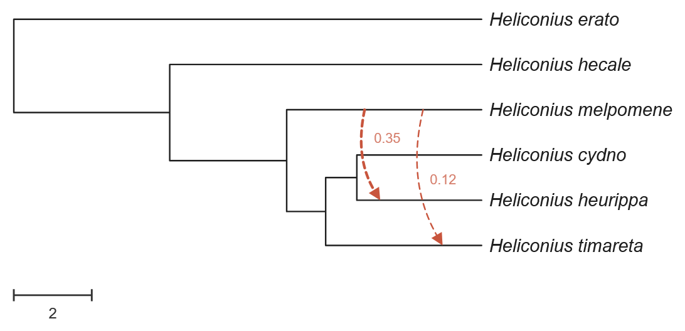<figcaption><b>Figure 24A.</b> The network drawn as its major tree, with each reticulation as an arrow from the donor to the hybrid lineage.</figcaption></figure>
    <figure>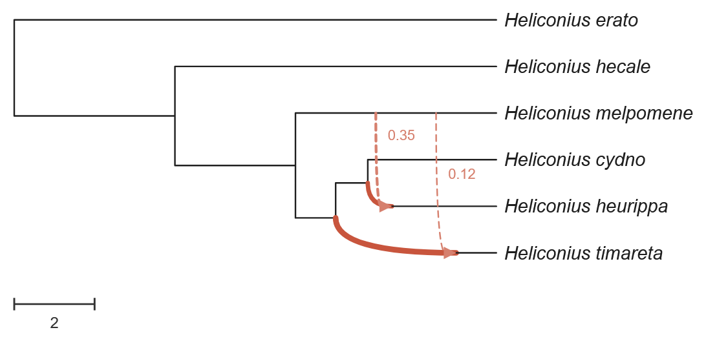<figcaption><b>Figure 24B.</b> The same network drawn in full, with both parental edges of each hybrid node.</figcaption></figure>
  </div>
</figure>

The reticulations are drawn as dashed lines from the donor lineage to the hybrid node. By default, an arrow points from the donor to the receiver (*Arrows* > `To hybrid`), but it can also point the other way, both ways, or not at all. With *Show a value on each line*, each line shows its γ, and with *Width from γ*, its width follows it. *Where on the branches* sets where each line starts and ends: `Centered` places them in the middle of the branches, while `Lengths` uses the ages written in the file. Like any other element, each line can be selected with a click and changed on its own from its `Right-click` menu.

Finally, *Style* switches between two views of the same network. `Major tree` draws the tree of the major edges, those that carry most of the genome, with each minor edge as a line from its donor (Fig. 24A), while `Full network` gives each hybrid node a point of its own, where its two parental edges meet (Fig. 24B).
